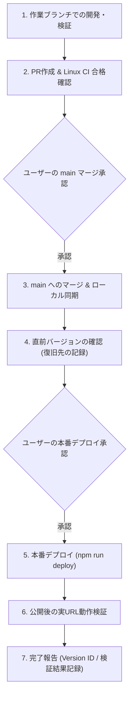

# bearworks.uk デプロイ・運用手順書（正本）

本書は、`bearworks.uk`（リポジトリ: `kumakit/bearworks-portal`）における本番公開・更新・運用の**正本ドキュメント**です。
開発者およびAIエージェント（Codex、Antigravityなど）は、サイトの変更・公開を行う際、必ず本書に定められた原則と手順に従わなければなりません。

---

## 1. 基本原則と安全ルール

1. **工程の完全な分離**:
   - 「PR作成」「CI成功の確認」「mainへのマージ」「本番公開（デプロイ）」は、**すべて独立した別工程**です。
   - 一つの工程が完了したからといって、次の工程を自動的に連続実行してはなりません。
2. **本番公開にはユーザーの明示的承認が必須**:
   - PRの作成、mainへのマージ、および本番公開の各段階で、必ずユーザーの明示的な承認（例: 「本番公開まで進めてください」「デプロイしてください」等の明示的指示）を得なければなりません。
   - CIの合格やPRマージの完了を、本番公開の承認とみなしてはなりません。
3. **既存のインフラ・セキュリティ設定の変更禁止**:
   - 既存のCloudflare設定（DNSレコード、Cloudflare Accessポリシー、Workers Route、Workerシークレット）を勝手に変更・削除してはなりません。
   - 通常のコンテンツ更新や機能追加において、Cloudflareのネットワーク設定変更は不要です。
4. **公開前の復旧先（ロールバック対象）の確認と記録**:
   - 本番デプロイを実行する前に、必ず現在稼働中の Worker バージョン（Deployment ID / Version ID）を読み取り専用で確認し、記録してください。
5. **公開後の実URL検証の必須**:
   - デプロイコマンドの終了コードだけで成功と判断せず、実際の公開URL（`https://bearworks.uk/...`）に対してHTTPステータス、広告境界、Access保護、ブラウザ描画・操作を確認してください。
6. **過去の移行手順の混同禁止**:
   - `docs/task/issue-344/cutover-runbook.md` などの過去資料に記載されている「Workers Routeの追加」「Pages連携の切断」等は、Cloudflare PagesからWorkersへの初回移行時の手順です。現在の通常運用手順として使用してはなりません。

---

## 2. システム構成と現在の運用状態

### アーキテクチャ概要
* **フロントエンド / サーバー**: Next.js (App Router)
* **ホスティング実行環境**: Cloudflare Workers（OpenNext Cloudflare アダプター `@opennextjs/cloudflare`）
* **本番ルーティング**:
  * ドメイン `bearworks.uk/*` へのトラフィックは、Cloudflare Workers Route により Worker `bearworks-portal` にバインドされています。
* **Cloudflare Pages との移行状況**:
  * 2026年8月（Issue #344）に Cloudflare Workers への完全移行が完了しています。
  * Cloudflare Pages の Git 自動ビルド連携は切断されており、GitHubへのpushによるPages自動デプロイは行われません。
  * Pages プロジェクトおよび既存デプロイは、Workers Route 削除時の非常時フォールバック先としてのみ残されています（日常運用では使用しません）。
* **アクセス制御（Cloudflare Access）**:
  * `/dashboard*` および `/api/dashboard-data` は Cloudflare Zero Trust (Access) により保護されています。
  * 未認証リクエストに対しては `302 Found`（Accessログイン画面へのリダイレクト）を返し、キャッシュヘッダーは `Cache-Control: no-store` を強制します。

> [!NOTE]
> Cloudflare側の実設定（ダッシュボード上の詳細ルール名や内部設定値など）をローカルCLIから直接確認できない場合は、推測で確定させず未確認事項として扱ってください。

---

## 3. 更新種別と本番反映の違い

本リポジトリで発生する更新には、以下の異なる種類が存在します。更新の性質を正しく識別してください。

| 更新種別 | 主な対象ファイル | 反映フロー | 本番公開（Worker更新） |
| :--- | :--- | :--- | :--- |
| **記事・コンテンツ更新** | `app/labs/...`, `scripts/...`, `public/...` | 作業ブランチ → バンドル検証 → PR作成 → CI合格 → mainマージ | **必要**（ユーザー承認後に `npm run deploy`） |
| **アプリケーションコード修正** | `app/...`, `components/...`, `package.json` | 作業ブランチ → ローカルテスト → PR作成 → CI合格 → mainマージ | **必要**（ユーザー承認後に `npm run deploy`） |
| **AIニュース自動データ更新** | `data/news-data.json` | OCI Worker が日次（毎朝06:15頃）で GitHub `main` に直接コミット・プッシュ | **自動公開されない**（次回のWorker公開時に反映） |

### 重要: AIニュースの自動更新と本番表示について
* `data/news-data.json` は OCI 上の自動処理により GitHub の `main` ブランチへ定期的にコミットされます。
* しかし、GitHub Actions には main push 連動の自動デプロイは存在せず、Cloudflare Pages の自動ビルドも停止しています。
* したがって、**GitHub main に AIニュースがコミットされても、本番サイト（`https://bearworks.uk/ai-news`）の表示は自動的には更新されません**。
* 新しい記事公開やコード更新に伴って Worker が本番デプロイされた際に、その時点の最新 `news-data.json` がバンドルされて本番に反映されます。
* AIエージェントは「GitHub main にコミットがあるから本番でも最新ニュースが表示されている」と誤認してはならず、また AIニュースの反映だけを目的にユーザー承認なく本番公開を行ってはなりません。

---

## 4. GitHub Actions の役割

リポジトリには以下の GitHub Actions ワークフローが存在しますが、**いずれも本番環境への自動デプロイは行いません**。

### 1. `Workers build` (`.github/workflows/workers-build.yml`)
* **トリガー**: Pull Request 作成・更新時、手動実行 (`workflow_dispatch`)
* **実行環境**: Ubuntu (Linux), Node.js 22, Python 3.12
* **役割**:
  * 依存関係の整合性確認（`npm ci`, `npm audit --omit=dev`, 監査ゲートテスト）
  * 各種データバンドルの生成・検証テスト（`npm run test:*`, `npm run validate:bundles`）
  * ESLint による静的解析（`npm run lint`）
  * Next.js ビルド（`npm run build`）
  * 内部リンクの prefetch ポリシー検証（`components/InternalLink.tsx` による意図しないRSC prefetch増幅の防止）
  * OpenNext Workers バンドルの生成（`npm run cf:build`）
  * Wrangler による dry-run 検証（本番および staging 設定の構文・バインディング検査）
  * **ローカル Workers preview サーバーでの E2E 検証**:
    * 各公開ページ（ルート、`/toukei`、`/labs/...` 等）の HTTP 200 確認
    * 不正 slug や存在しないルートの 404 確認
    * **AdSense 境界の厳格な検証**（広告対象ページにのみテスト用 ID が含まれ、非広告ページ・404・ダッシュボードには一切含まれないこと）
    * 静的アセットのキャッシュヘッダー（`immutable`）確認
    * 未認証ダッシュボード API の 401 / 405 / `no-store` 確認
  * 検証済みアーティファクトの保存（デプロイは実行しない）

### 2. `Production Workers artifact` (`.github/workflows/workers-production-build.yml`)
* **トリガー**: main ブランチでの手動実行 (`workflow_dispatch`) のみ
* **役割**:
  * 本番用 AdSense Client ID (`ca-pub-9560028085973137`) を注入したビルド
  * dry-run による構文検証
  * 本番用アーティファクトの保存（**外部へのデプロイは実行しない**）

---

## 5. 本番公開（デプロイ）標準手順

本番公開は、以下の手順を順番に確実に踏んで実施します。



### ステップ 1: 前提条件の確認
1. 対象の変更を含むブランチについて、GitHub Actions (`Workers build`) が**全ステップ成功**していること。
   > [!WARNING]
   > Windows ローカル環境では OpenNext の Windows 非互換警告が発生します。そのため、本番公開前には必ず同一コミットに対する Linux CI の成功を確認しなければなりません。
2. ユーザーの明示的な承認を得て、PR を main ブランチへ通常マージ（履歴保持）していること。
3. ローカルの作業ツリーで最新の `origin/main` を fetch/pull し、未コミット変更がない clean な状態であること。
4. 対象コミットの Git tree が、CI で検証された Git tree と一致していることを確認すること。

### ステップ 2: 直前の公開バージョン確認（復旧先の確定）
デプロイを実行する前に、現在配信中の Worker バージョンを確認し、記録します。

```powershell
npx wrangler deployments list --env=""
```

* 出力された直前の **Deployment ID** および **Version ID** をメモし、万が一のロールバック先として記録します。

### ステップ 3: 本番公開の明示的承認の取得
* ユーザーに対し、公開対象のコミットSHA、含まれる変更内容、および直前バージョン（復旧先）を提示し、本番デプロイの明示的承認を求めます。
* 承認が得られるまで、次のステップへ進んではなりません。

### ステップ 4: 本番デプロイの実行
承認後、本番 AdSense クライアント ID を環境変数に設定した上でビルドおよびデプロイを実行します。

```powershell
# 本番AdSense IDを設定（ads.txt と一致する ca-pub-9560028085973137）
$env:NEXT_PUBLIC_ADSENSE_CLIENT_ID = "ca-pub-9560028085973137"

# デプロイの実行（バンドル検証 → OpenNextビルド → Workerデプロイ）
npm run deploy
```

> [!NOTE]
> Wrangler の出力に `No targets deployed` と表示される場合がありますが、これは top-level 設定に routes 構文が直接書かれていないための表示です（Cloudflare ダッシュボード側で Workers Route が `bearworks.uk/*` にバインドされています）。デプロイ後に返される Deployment ID / Version ID を確認してください。

### ステップ 5: 公開後の実URL検証
デプロイ完了後、直ちに実際の公開 URL に対して以下の検証を実施します。

1. **HTTP ステータスとレスポンス確認**:
   * トップページ (`https://bearworks.uk/`) が 200 を返すこと。
   * 新規公開・更新された記事 URL が 200 を返し、正しい HTML・メタデータが描画されていること。
   * 存在しない URL（例: `/not-found-test-slug`）が 404 を返すこと。
2. **広告境界の確認**:
   * 広告対象ページ（ルート、`/toukei`、対象の Labs 記事など）に本番 AdSense ID (`ca-pub-9560028085973137`) が含まれていること。
   * 非広告ページ（`/about`、`/ai-news`、`/contact`、`/privacy`、`/weather`、`/dashboard`）および 404 ページに **AdSense 関連コードが一切含まれていないこと**。
3. **Cloudflare Access 保護の確認**:
   * 未認証状態で `https://bearworks.uk/dashboard` および `https://bearworks.uk/api/dashboard-data` にアクセスした際、Cloudflare Access のログイン画面へ 302 リダイレクトされること。
   * キャッシュヘッダーに `Cache-Control: no-store` が付与されていること。
4. **ブラウザ動作確認**:
   * ブラウザで実際のページを開き、レイアウト崩れ、JavaScript エラー（コンソールエラー）、インタラクティブ要素（グラフの切り替え、アコーディオンなど）の動作を確認すること。
5. **付属ファイルの確認**:
   * `https://bearworks.uk/ads.txt` が 200 で正しい publisher 行を返すこと。
   * `https://bearworks.uk/sitemap.xml` および `robots.txt` が正常に取得できること。

### ステップ 6: 完了記録
作業結果を記録します（作業ログまたはタスク記録ファイル）。
* 公開日時（JST / UTC）
* 公開対象コミット SHA
* 新しい Deployment ID / Version ID
* 更新前の Deployment ID / Version ID（復旧先）
* 公開後検証の結果

---

## 6. ロールバック手順

公開後に重大な問題（5xxエラーの多発、意図しない404、Access保護の迂回、広告境界違反、秘密情報の露出など）が確認された場合、以下の手順で速やかにロールバックを実施します。

### 通常時のロールバック（Worker Version ロールバック）
直前の Worker バージョンへトラフィックを戻します。

```powershell
# デプロイ一覧で直前の Version ID / Deployment ID を確認
npx wrangler deployments list --env=""

# 直前のバージョンへロールバック
npx wrangler rollback <PREVIOUS_DEPLOYMENT_ID> --name bearworks-portal --yes --message "Rollback to pre-release version"
```

* ロールバック後、`https://bearworks.uk/` にアクセスし、旧バージョンへの復帰と正常稼働を確認します。

### 非常時のロールバック（Workers Route 削除による Pages フォールバック）
Worker 自体が起動不能になる等の壊滅的な障害が発生し、Worker バージョンロールバックでも復旧しない場合に限り、Cloudflare ダッシュボードから Workers Route を削除して旧 Pages 環境へ戻します。

> [!CAUTION]
> Workers Route の削除はサイト全体に大きな影響を与える非常措置です。安易に実行せず、必ずユーザーの明示的な判断・指示のもとで実施してください。

1. Cloudflare ダッシュボード > **Workers & Pages** > `bearworks-portal` > **Settings** > **Domains & Routes** を開く。
2. Route `bearworks.uk/*` を削除する（DNS レコードや Pages プロジェクトは変更しない）。
3. 数分待ち、Pages 環境へのフェイルオーバーと各ページの稼働を確認する。
